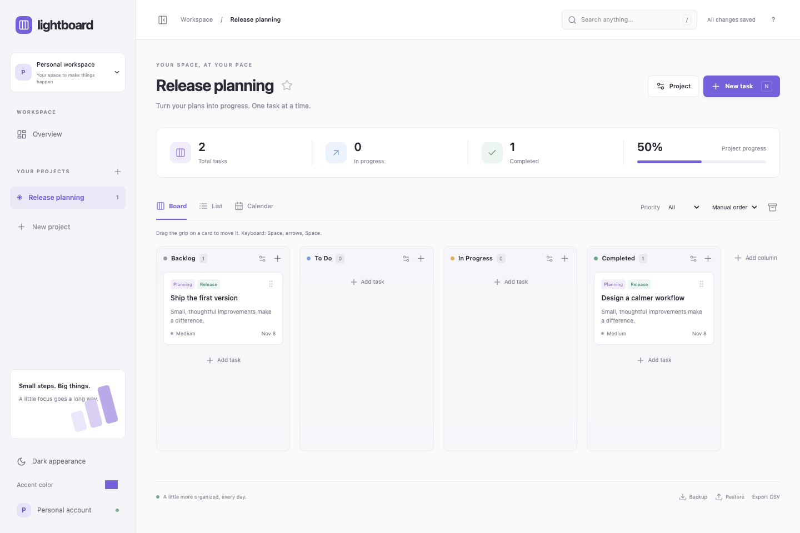

# Lightboard

A quiet place to get things done. A self-hosted, single-user Kanban and task manager built with React, TypeScript, Vite, Tailwind, dnd-kit, and a small Cloudflare Worker backed by D1.

## Start locally

Requires Node.js 22.12+ (or a current supported Node release) and npm. No Cloudflare account is needed for local work.

```sh
npm ci
cp .dev.vars.example .dev.vars
npm run build
npm run db:migrate
npm run api
```

In another terminal, run `npm run dev` and visit the URL Vite prints (usually http://127.0.0.1:5173). Vite proxies `/api` to Wrangler on port 8787. Alternatively, visit http://127.0.0.1:8787 to use the production build. Run `npm run build` again after changes when using that URL. Wrangler persists local D1 in `.wrangler/state`; task data is never stored in localStorage. LocalStorage holds theme and accent preferences only.

The app starts empty. Create a project, add tasks, and move cards with their drag handles. Keyboard dragging: focus a handle, Space, arrow keys, Space. The local authentication bypass is explicit and accepted only on loopback hostnames. Do not expose the local dev server publicly.

## Included

- Independent projects with default Backlog, To Do, In Progress, Completed columns
- Custom column names, colors, completion semantics, and deletion with task reassignment
- Inline task creation and persistent card ordering, mouse/touch and keyboard drag and drop
- Task editing, descriptions, priorities, dates, labels, checklist/subtasks
- Complete/reopen, duplicate, archive/restore and confirmed deletion
- Favorite projects, custom project icons/colors, archive/delete projects
- Board, sortable list, month calendar and dashboard views
- Due today, overdue, upcoming, in-progress and recent completion summaries
- Global search, priority filtering, due-date/priority sorting
- Dark theme, accent color, collapsible sidebar and responsive layouts
- JSON backup/restore, CSV export and keyboard shortcuts (`N`, `/`, `?`, Escape)
- D1 migrations, transactional saves, optimistic rollback and concurrent-tab protection
- Single-user access-key login with signed HttpOnly sessions, plus optional server-side Access JWT signature, issuer, expiration and audience verification; same-origin mutation checks



[Mobile screenshot](docs/mobile.png)

## Deploy on Cloudflare Free

Use a Workers Free account and D1 Free. No paid APIs, custom domain, container, persistent server, polling or realtime service is required. Cloudflare quotas still apply; the app stops serving API requests if you exhaust them. Select free plans during account setup; Cloudflare signup terms and plan availability are controlled by Cloudflare.

1. `npx wrangler login`
2. `npx wrangler d1 create lightboard`
3. Replace only the placeholder `database_id` in `wrangler.jsonc` with the returned ID. The configuration contains no personal account ID. For a public repository, keep your real deployment configuration in an ignored `wrangler.local.jsonc` and pass `--config wrangler.local.jsonc` to Wrangler commands. Add that filename to your personal ignore rules.
4. `npx wrangler d1 migrations apply DB --remote`
5. `npm run build` then `npx wrangler deploy`. The static shell can load at the provided `workers.dev` URL, but the API denies requests until authentication is configured.
6. Generate a random access key locally: `openssl rand -hex 32`. Store it in your password manager, then run `npx wrangler secret put SINGLE_USER_KEY` and paste the key at the prompt. Never put it in source code, Wrangler's public vars, or a URL. This path needs no Zero Trust enrollment or payment details.
7. Open your `workers.dev` URL and enter that key. The server compares key digests and issues a seven-day, signed, HttpOnly, Secure, SameSite=Strict cookie. The key is never stored in localStorage or bundled frontend code. There is no password database, user registration or recovery service. Rotate `SINGLE_USER_KEY` to revoke all existing sessions; the help dialog offers sign out for the current browser. Use a randomly generated key of at least 32 characters, not a human-chosen password.
8. Never set `LOCAL_DEV` in remote bindings. Check that an incognito visit asks for the key and an unauthenticated request to `/api/data` returns 401. Preview URLs should be disabled or protected with the same configuration.

**Optional Cloudflare Access:** Access can replace the key login if you already use Zero Trust. Cloudflare's [Zero Trust onboarding documentation](https://developers.cloudflare.com/learning-paths/clientless-access/initial-setup/create-zero-trust-org/) requires payment details even for the Free plan, so it is not required by this app. Enable Access for your Workers hostname, allow only your email via one-time PIN, and set `ACCESS_TEAM_DOMAIN` and `ACCESS_AUD` using `wrangler secret put`. The team domain must be `https://YOUR-TEAM.cloudflareaccess.com`; AUD is the application's audience tag. Remove the `SINGLE_USER_KEY` secret if you want Access to be the only authentication method. When both modes are configured, either valid credential authorizes the same single-user instance. Verify the full [Workers Access setup](https://developers.cloudflare.com/workers/configuration/cloudflare-access/) and test all enabled URLs before storing private data.

The shell and bundled frontend assets contain no task data or secrets and may be served publicly. All task data is fetched through the protected API. Separate deployments have separate D1 databases. There is no multi-user data partitioning: anyone with the instance key or allowed by your Access policy sees the same single-user instance.

Official references: [Workers assets](https://developers.cloudflare.com/workers/static-assets/), [D1 limits](https://developers.cloudflare.com/d1/platform/limits/), [Workers limits](https://developers.cloudflare.com/workers/platform/limits/), [Access JWT verification](https://developers.cloudflare.com/cloudflare-one/access-controls/applications/http-apps/authorization-cookie/validating-json/). Confirm current free plan quotas before deploying.

## Database, safety, and backups

Three domain tables (projects, columns, tasks) plus a single revision row. Checklist and label arrays are stored as JSON. Project/order and due-date indexes keep queries simple. One snapshot read loads an instance; no polling occurs. A mutation sends a snapshot; the Worker validates it, compares records, and updates only changed rows in a D1 transaction. An atomic revision guard rejects concurrent stale saves. Refresh to load another tab's changes; merging concurrent changes is intentionally out of scope. This design favors one person and hundreds of tasks, with hard limits of 100 projects, 500 columns, 5,000 tasks and a 2 MB import payload. Large imports may encounter D1 platform limits and will roll back atomically if they do.

Use **Backup** to download JSON before destructive changes. **Restore** validates and transactionally replaces all workspace data after confirmation. CSV is for spreadsheet use and is not a restore format. Backups contain private task data: store them securely and do not commit them. For database-level backups, use `npx wrangler d1 export DB --remote --output backup.sql` and keep the resulting file outside the repository. Apply future schema changes as new numbered migrations; never edit an already-applied migration.

Local API failure rolls back optimistic state and displays an error. The task editor stays open when a save fails. If a response is lost after a committed save, reload before retrying. All SQL values are parameterized. JSON imports are data only; React renders task content as text.

## Checks and structure

```sh
npm test
npm run build
# Chrome must be installed. Uses a separate disposable local D1 state.
npm run test:e2e
```

- `src/main.tsx`: shell, board, task/project/column editors and client saves
- `src/views.tsx`: lazy-loaded list, calendar and dashboard
- `src/model.ts`: shared data model and pure ordering logic
- `worker/index.ts`: authentication, validation and D1 API
- `migrations/`: SQLite schema
- `tests/`: ordering, backup validation and authorization tests

Manual release checks: create/edit/complete/delete, reorder and refresh, move across columns, switch projects and views, mobile widths, failed-save rollback, unauthenticated API, and backup/restore. Automated tests are a foundation, not a substitute for deployment verification.

## Future scope and release status

Potential enhancements: label filter chips, recurring tasks, saved filters, task templates, virtualized lists for much larger instances, optional table view. No teams or automation engine is planned for this version.

No license has been selected. All rights are reserved until the owner chooses a license; add `LICENSE` before publishing as open source. Browser tests exercise real local D1 task CRUD, pointer dragging, persistence after refresh, stale-write rejection, views, backups, failed-save recovery and mobile overflow. They use `.wrangler/e2e-state` on port 8788, separate from normal local data.

No GitHub repository is created and no deployment is performed automatically. Screenshots use synthetic example tasks only.
